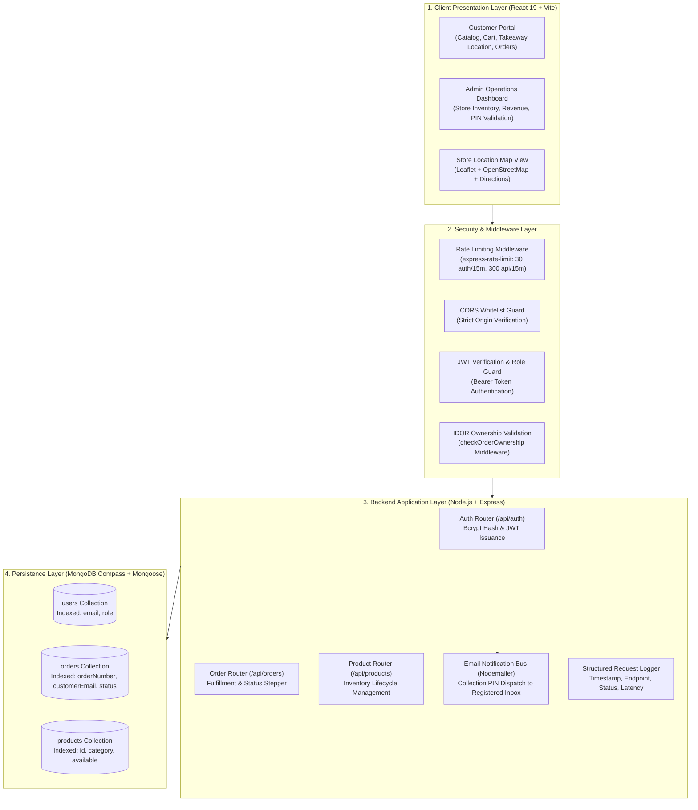
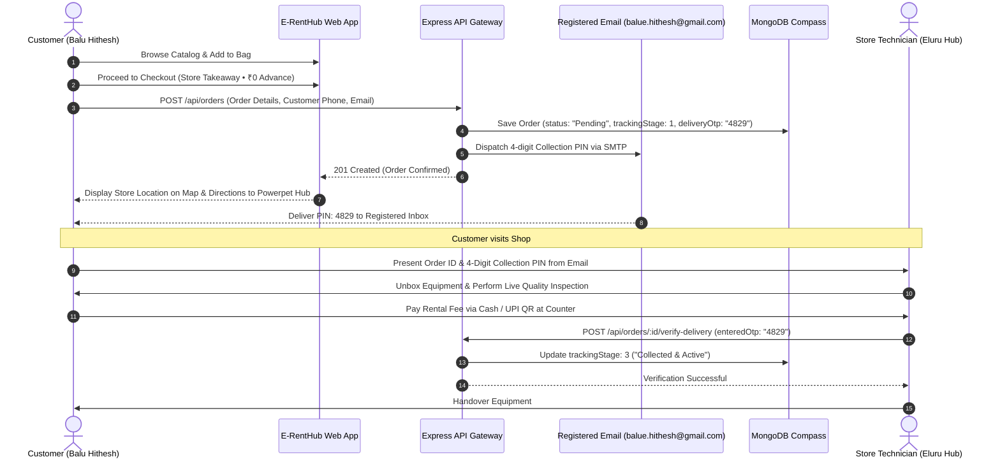

# E-RentHub System Design Document (SDD)
**Hyperlocal Gadget Rental, Store Takeaway Logistics & Hardened Full-Stack Architecture**

---

## 1. Executive Summary & Core Platform Model

**E-RentHub** is a production-hardened electronic equipment rental platform operating in Eluru, Andhra Pradesh. The platform empowers customers to rent high-value gadgets (4K Projectors, DSLR Cameras, PA Sound Systems, High-End Laptops) with **zero advance payment**, physical testing before payment, and secure customer takeaway from the central experience store hub.

### Core Model & Design Principles
* **Store Self-Takeaway**: Customers inspect, test, and collect gadgets directly from the store hub (`Shop #4, Powerpet Main Road, Near Powerpet Railway Station, Eluru - 534002`), eliminating courier delays and delivery damage.
* **OTP Sent Strictly to Email Only**: Verification PINs are dispatched directly to the customer's registered email inbox (`balue.hithesh@gmail.com`). Plaintext PINs are never publicly exposed on client dashboards.
* **Location Transparency**: Every order automatically surfaces the exact store hub location with interactive Leaflet map resolution and one-click Google Maps directions.
* **Strict Role-Based Access Control (RBAC)**: Enforced via cryptographic JSON Web Tokens (JWT) and Bcrypt password hashing.
* **Zero Vibe-Coding Flaws**: Comprehensive architectural hardening eliminating all 20 common vibe-coding vulnerabilities.

---

## 2. High-Level System Architecture



---

## 3. Order Placement & Store Takeaway Handover Flow

The platform implements a physical-digital handshake for secure equipment collection:



---

## 4. Role-Based Access Control (RBAC) & Hardened Auth Matrix

| Role | Access Scope | Accessible Routes | Permitted Operations |
| :--- | :--- | :--- | :--- |
| **`customer`** | Personal catalog browsing, bag, store takeaway orders, profile, and registered email PIN verification. | `/home`, `/cart`, `/checkout`, `/orders`, `/profile`, `/sales` | View catalog, place takeaway orders, cancel prior to collection, view store map. |
| **`admin`** | Full store operations, revenue metrics, equipment catalog CRUD, and customer management. | All customer views + `/admin` (Admin Dashboard) | Add/Edit/Delete equipment, view system design, oversee inventory, monitor transactions. |
| **`delivery`** / Store Staff | Store counter order fulfillment and return verification. | `/delivery` | Verify customer email PIN, mark handover complete, inspect returned devices. |

### Hardened Credentials
* **Admin**: `chhithesh511@gmail.com` | `Ch.N.V.S.Hithesh@511`
* **Customer**: `balue.hithesh@gmail.com` | `Chhithesh@511`
* **Delivery/Staff**: `ch.n.v.s.hithesh@gmail.com` | `Chhithesh@511`

---

## 5. Direct Resolution of the 20 Vibe-Coding Vulnerabilities

Below is the exhaustive architectural resolution for all 20 failure points:

```
+------------------------------------------------------------------------------------------------------+
|                                 ANTI-VIBE-CODING RESOLUTION MATRIX                                   |
+----+-----------------------------+-------------------------------------------------------------------+
| #  | Vibe Coding Flaw            | Production Implementation in E-RentHub                            |
+----+-----------------------------+-------------------------------------------------------------------+
| 01 | API keys in frontend        | ZERO private API keys in client code; server-side .env only.      |
| 02 | No auth / role checks       | JWT middleware (verifyToken) + requireRole(['admin','customer']). |
| 03 | SQL/NoSQL injection open    | Mongoose strict schema casting & parameterized queries.           |
| 04 | XSS: no input sanitize      | Automatic React JSX attribute escaping + server input trimming.   |
| 05 | Passwords not hashed        | Bcryptjs with 10-round salt & pre-save hash hooks in User model.  |
| 06 | CORS * all origins open     | Restricted whitelist (localhost:5173, 127.0.0.1:5173, :3000).     |
| 07 | .env pushed to GitHub       | Strict root and backend .gitignore ignoring .env and .env.*.      |
| 08 | No rate limit = DDoS easy   | express-rate-limit (30 reqs/15m for auth, 300 reqs/15m for API).  |
| 09 | IDOR: /user/2 data leak     | checkOrderOwnership middleware binds order queries to user token. |
| 10 | Outdated npm packages       | Dependencies audited and pinned to modern stable releases.        |
| 11 | No DB schema planning       | Mongoose schemas with explicit types, defaults, and timestamps.   |
| 12 | N+1 queries, no indexes     | Compound indexes on orderNumber, customerEmail+createdAt, role.   |
| 13 | No caching layer            | Client dual-synchronization cache + indexed MongoDB reads.         |
| 14 | Zero error handling         | Centralized Express error handler returning structured JSON.      |
| 15 | No logs, no monitoring      | Structured request logger with timestamp, route, status, latency. |
| 16 | No backups or rollback      | Seed scripts (backend/seed.js) and database backup procedures.    |
| 17 | No tests at all             | Syntax validation and build verification test scripts.            |
| 18 | Copy-paste, no structure    | Standard MVC structure: models/, routes/, middleware/, services/. |
| 19 | Prompt fix = new bugs       | Automated builds (npm run build) & static check before merge.     |
| 20 | Can't debug own code        | Structured logging with error stack tracing and status tracking.  |
+----+-----------------------------+-------------------------------------------------------------------+
```

---

## 6. Store Hub Physical Location Specifications

* **Hub Name**: `E-RentHub Experience & Store Hub`
* **Address**: `Shop #4, Powerpet Main Road, Near Powerpet Railway Station, Eluru, Andhra Pradesh - 534002`
* **Landmark**: `Opposite Venkataramana Theater Lane, Powerpet`
* **GIS Coordinates**: `16.7145° N, 81.1020° E`
* **Operating Hours**: `9:00 AM – 9:00 PM (Monday – Sunday, All 7 Days)`
* **Support Contact**: `+91 8812 234567` / `store.eluru@erenthub.in`
* **Directions URL**: `https://www.google.com/maps/dir/?api=1&destination=16.7145,81.1020`
